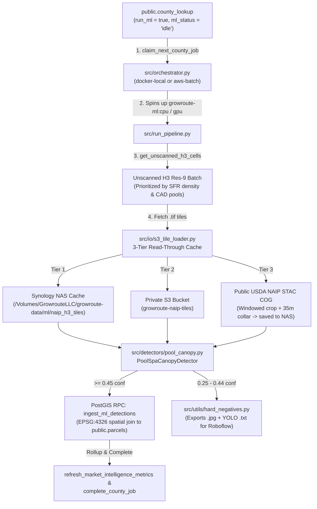

# growroute-ml-engine 🛰️🏊

The computer vision, aerial imagery, and spatial post-processing engine for **GrowRoute**.

`growroute-ml-engine` scans residential H3 (Resolution 9) cells across US counties using 4-band USDA NAIP aerial GeoTIFFs (`RGB + Near-Infrared`), runs **YOLO11s-seg** instance segmentation (`task="segment"`) to detect swimming pools and spas, computes surrounding **15m tree canopy coverage** (via 4-band NIR NDVI or RGB Excess Green), classifies **pool water condition** (`clean` vs. `green`), mines borderline detections for **Roboflow active learning**, and spatially joins detections back to `public.parcels` in Supabase/PostGIS.

---

## 🏗️ End-to-End Pipeline Flow



### How Each Stage Works

1. **County Job Queue (`src/orchestrator.py`):**
   - Polls `public.county_lookup` via the `claim_next_county_job` RPC (prioritizing `parcel` jobs first, then `ml` jobs where `run_ml = true` and `ml_status = 'idle'`).
   - In `docker-local` mode, mounts the Synology NAS (`ml/naip_h3_tiles` -> `/app/tiles_cache` and `ml/training_runs` -> `/app/runs`) and runs `growroute-ml:cpu`.
   - Marks the job `completed` or `failed` via `complete_county_job`.

2. **H3 Res-9 Prioritization (`get_unscanned_h3_cells`):**
   - Queries `public.parcels` for H3 cells in the target county where `ai_last_verified_at IS NULL`.
   - Orders cells by single-family residential density (`30–250` parcels per hex) and known CAD pool count so high-yield suburban neighborhoods are scanned first.

3. **3-Tier Read-Through NAIP GeoTIFF Loader (`src/io/s3_tile_loader.py`):**
   - **Tier 1 (Local Synology NAS):** Checks `/Volumes/GrowrouteLLC/growroute-data/ml/naip_h3_tiles/<county>/tx_<county>_hex_<h3>.tif`.
   - **Tier 2 (Private S3):** Checks `s3://growroute-naip-tiles/tx/h3_res9/<county>/<h3>.tif`.
   - **Tier 3 (USDA NAIP STAC COG Fallback):** Queries Microsoft Planetary Computer's public `naip` STAC catalog for the H3 cell bounding box (+ `35m` collar so boundary pools are never clipped), streams only the cropped 4-band (`R, G, B, NIR`) GeoTIFF window in native UTM projection (`EPSG:26914`), and persists it to the NAS.

4. **Computer Vision & Geospatial Feature Extraction (`src/detectors/pool_canopy.py`):**
   - **RGB-to-BGR Conversion:** Reads bands `(1, 2, 3)` via `rasterio`, converts `RGB -> BGR` for Ultralytics `YOLO(..., task="segment")`, and extracts band `4` (`NIR`) when present.
   - **Pool & Spa Segmentation:** Runs `YOLO11s-seg` (`classes: {0: 'pool', 1: 'spa'}`). Associates any detected `spa` within `20m` of a pool centroid (`has_spa = true`) and estimates `pool_sqft` from the ground sample distance (`meters_per_px`).
   - **CRS Reprojection (`EPSG:26914` -> `EPSG:4326`):** Converts pixel centroids `(cx, cy)` via the GeoTIFF affine transform (`rasterio.transform.xy`) and reprojects from native UTM meters (`EPSG:26914`) to WGS84 (`lng`, `lat`) via `rasterio.warp.transform`.
   - **15m Tree Canopy Ring:** Masks a `15m` buffer ring around each pool bounding box and computes `ai_tree_canopy_pct` (`0–100%`) using 4-band `NDVI = (NIR - Red) / (NIR + Red)` + shade threshold (or RGB Excess Green + HSV fallback). Sets `tree_overhang = true` in PostGIS when `>= 35%`.
   - **Pool Water Clarity:** Evaluates inner-crop HSV hue/saturation to classify `cv_pool_condition` as `"clean"` or `"green"` (algae).
   - **Hard-Negative Mining (`src/utils/hard_negatives.py`):** Any borderline detections in `[0.25, 0.44]` confidence are exported as 95%-quality `.jpg` tiles + YOLO `.txt` pre-labels in `./runs/hard_negatives/` for rapid Roboflow relabeling.

5. **PostGIS Spatial Join & Rollup (`ingest_ml_detections` & `refresh_market_intelligence_metrics`):**
   - Stamps all parcels in `p_scanned_h3_cells` with `ai_last_verified_at = now()`.
   - Spatially joins each detection point (`ST_SetSRID(ST_MakePoint(lng, lat), 4326)`) against `public.parcels.geom` using the GIST spatial index (`ST_Contains` prioritized, with a `~20m` `ST_DWithin` tolerance for slight aerial orthorectification offsets).
   - Updates `ai_has_pool`, `cv_has_pool`, `ai_pool_confidence`, `ai_tree_canopy_pct`, `tree_overhang`, `pool_sqft`, `cv_pool_condition`, `cad_has_spa`, and `pool_detection_source` (`'both'` or `'ai'`), then refreshes county-level totals in `public.county_lookup`.

---

## 📂 Repository Structure

```text
growroute-ml-engine/
├── .env.example                 # Environment variable template (Supabase, AWS, Roboflow)
├── .dockerignore                # Excludes .venv, local caches, and .pt weights from Docker context
├── Dockerfile.cpu               # Local/Staging ONNX Runtime CPU container (growroute-ml:cpu)
├── Dockerfile.gpu               # AWS Batch CUDA 12.1 + ONNX Runtime GPU container (growroute-ml:gpu)
├── docker-compose.yml           # Compose service definition for ml-worker (2560m limit, NAS mounts)
├── Makefile                     # Shortcuts: make build-cpu, make queue-dfw, make run-parallel
├── requirements.txt             # Python dependencies (ultralytics, rasterio, onnxruntime, h3, supabase)
├── scripts/
│   └── run_parallel_dfw.sh      # Helper script to launch parallel multi-county Docker workers
├── configs/
│   └── pipeline.yaml            # Model paths, confidence thresholds, canopy buffer (15m), S3 config
├── models/
│   ├── pool_spa_dfw_v2.onnx     # Production YOLO11s-seg ONNX model (input: 640x640, classes: pool, spa)
│   └── pool_spa_dfw_v2.pt       # PyTorch YOLO11s-seg checkpoint
├── src/
│   ├── orchestrator.py          # Multi-worker ThreadPoolExecutor polling public.county_lookup
│   ├── run_pipeline.py          # Per-county worker: fetches H3 cells, runs YOLO + Canopy, flushes RPCs
│   ├── dry_run_local.py         # Offline smoke-test script on local .tif/.jpg tiles (no DB writes)
│   ├── detectors/
│   │   └── pool_canopy.py       # GeoTIFF loader, CRS reprojection, YOLO11s-seg, NDVI canopy, water check
│   ├── io/
│   │   └── s3_tile_loader.py    # 3-tier tile loader (Synology NAS -> Private S3 -> USDA NAIP STAC COG)
│   └── utils/
│       └── hard_negatives.py    # Saves borderline [0.25, 0.44] detections as .jpg + .txt for Roboflow
├── training/
│   ├── pull_roboflow.py         # Downloads labeled YOLO datasets from Roboflow to ./data
│   ├── tif_to_jpg.py            # Batch converts 4-band NAIP .tif tiles to 3-band .jpg for labeling
│   └── train_yolo.py            # Trains YOLO11s-seg on MPS/CUDA and exports .pt + simplified .onnx
├── data -> /Volumes/GrowrouteLLC/growroute-data/parcels
├── runs -> /Volumes/GrowrouteLLC/growroute-data/ml/training_runs
└── tiles_cache -> /Volumes/GrowrouteLLC/growroute-data/ml/naip_h3_tiles
```

---

## ⚙️ Setup & Installation

### 1. Local Python Virtual Environment
```bash
cd /Users/karthik/growroute-llc/github/growroute/growroute-ml-engine

python3 -m venv .venv
./.venv/bin/pip install --upgrade pip
./.venv/bin/pip install -r requirements.txt
```

### 2. Environment Variables (`.env`)
Copy `.env.example` to `.env` and populate your credentials:
```bash
cp .env.example .env
```
Required keys in `.env`:
- `SUPABASE_URL` — Supabase project URL
- `SUPABASE_SERVICE_ROLE_KEY` — Service role key (required to invoke `SECURITY DEFINER` RPCs)
- `S3_TILES_BUCKET` / `S3_TILES_PREFIX` — Optional S3 cache bucket (`growroute-naip-tiles`)
- `ROBOFLOW_API_KEY` — Optional, used by `training/pull_roboflow.py`

### 3. Build the Local CPU Docker Image
Whenever `src/`, `configs/`, or `models/pool_spa_dfw_v2.onnx` changes, rebuild `growroute-ml:cpu`:
```bash
cd /Users/karthik/growroute-llc/github/growroute/growroute-ml-engine
docker build -f Dockerfile.cpu -t growroute-ml:cpu .
```

---

## 🚀 How to Run ML Detection

Make sure your Synology NAS SMB share is mounted at `/Volumes/GrowrouteLLC/growroute-data` before running local jobs.

### 1. Run ML Detection for a Single County (via Orchestrator + Local Docker)

**Step A — Queue the county in `public.county_lookup`:**
For example, to queue **Tarrant County (`48439`)** for 500 tiles (or `10000` for a full county run):
```bash
cd /Users/karthik/growroute-llc/github/growroute/growroute-ml-engine

./.venv/bin/python3 -c '
import os
from dotenv import load_dotenv
from supabase import create_client

load_dotenv()
sb = create_client(os.environ["SUPABASE_URL"], os.environ["SUPABASE_SERVICE_ROLE_KEY"])
sb.table("county_lookup").update({
    "run_ml": True,
    "ml_status": "idle",
    "ml_max_tiles": 500,
    "last_pipeline_error": None
}).eq("county_fips", "48439").execute()
print("Queued Tarrant (48439)")
'
```

**Step B — Run the Orchestrator:**
```bash
./.venv/bin/python3 -m src.orchestrator \
  --executor docker-local \
  --nas-root /Volumes/GrowrouteLLC/growroute-data
```

---

### 2. Run ML Detection for All Counties (Sequential Local Docker Queue)

**Step A — Queue all counties in `public.county_lookup`:**
```bash
cd /Users/karthik/growroute-llc/github/growroute/growroute-ml-engine

./.venv/bin/python3 -c '
import os
from dotenv import load_dotenv
from supabase import create_client

load_dotenv()
sb = create_client(os.environ["SUPABASE_URL"], os.environ["SUPABASE_SERVICE_ROLE_KEY"])
res = sb.table("county_lookup").update({
    "run_ml": True,
    "ml_status": "idle",
    "ml_max_tiles": 10000,
    "last_pipeline_error": None
}).neq("county_fips", "").execute()
print("Queued counties:", [r["county_name"] for r in (res.data or [])])
'
```
*(Or via SQL in Supabase Studio:)*
```sql
UPDATE public.county_lookup
SET run_ml = true,
    ml_status = 'idle',
    ml_max_tiles = 10000,
    last_pipeline_error = NULL;
```

**Step B — Start the Parallel Orchestrator (`--max-workers 3`):**
```bash
./.venv/bin/python3 -m src.orchestrator \
  --executor docker-local \
  --max-workers 3 \
  --nas-root /Volumes/GrowrouteLLC/growroute-data
```
*(Or use `./scripts/run_parallel_dfw.sh` or `make run-parallel MAX_WORKERS=3`. Append `--watch` to keep polling `public.county_lookup` every 30 seconds.)*

* **Mac mini Resource Protection:** `src/orchestrator.py` dynamically scales `OMP_NUM_THREADS = max(1, 6 // max_workers)` (`2` threads per container when `max_workers=3`), sets `TILE_LOADER_WORKERS=4`, and caps each container at `--memory=2560m`, streaming prefixed output lines (`[COLLIN | 48085] ...`).

---

### 3. Run `src.run_pipeline` Directly (Without the Queue Table)

You can invoke `src.run_pipeline` directly for a specific county either on the host (with Apple Silicon `mps` or `cpu`) or inside Docker:

**Using Local `.venv`:**
```bash
cd /Users/karthik/growroute-llc/github/growroute/growroute-ml-engine

./.venv/bin/python3 -m src.run_pipeline \
  --county TARRANT \
  --device cpu \
  --batch-tiles 100 \
  --max-tiles 200
```

**Using `docker run` Directly:**
```bash
docker run --rm \
  --env-file /Users/karthik/growroute-llc/github/growroute/growroute-ml-engine/.env \
  -v /Volumes/GrowrouteLLC/growroute-data/ml/naip_h3_tiles:/app/tiles_cache \
  -v /Volumes/GrowrouteLLC/growroute-data/ml/training_runs:/app/runs \
  growroute-ml:cpu \
  --county TARRANT \
  --device cpu \
  --batch-tiles 100 \
  --max-tiles 200
```

---

### 4. Offline Dry-Run Verification (No Database Writes)

To test model inference, coordinate reprojection (`EPSG:26914` -> `EPSG:4326`), and canopy estimation on cached local `.tif` tiles without writing to Supabase:

```bash
cd /Users/karthik/growroute-llc/github/growroute/growroute-ml-engine

./.venv/bin/python3 -m src.dry_run_local \
  --tiles-dir /Volumes/GrowrouteLLC/growroute-data/ml/naip_h3_tiles/tarrant \
  --model models/pool_spa_dfw_v2.onnx \
  --limit 5
```

---

## 🧠 Retraining & Active-Learning Workflow

1. **Collect Hard Negatives Automatically:**
   During production runs, `HardNegativeMiner` saves borderline tiles (`0.25–0.44` confidence) to `/Volumes/GrowrouteLLC/growroute-data/ml/training_runs/hard_negatives/{images,labels}`.
2. **Upload & Relabel in Roboflow:**
   Drag-and-drop the `hard_negatives/` folder into Roboflow, correct false positives/missed pools, and generate a new dataset version.
3. **Pull Dataset & Train New Checkpoint:**
   ```bash
   # 1. Download labeled dataset version from Roboflow
   ./.venv/bin/python3 training/pull_roboflow.py \
     --workspace <workspace> \
     --project <project> \
     --version 3 \
     --format yolov11 \
     --out-name pool_spa_dfw_v3

   # 2. Train YOLO11s-seg and auto-export both .pt and .onnx to ./models/
   ./.venv/bin/python3 training/train_yolo.py \
     --dataset data/pool_spa_dfw_v3 \
     --base-model models/pool_spa_dfw_v2.pt \
     --epochs 80 \
     --imgsz 640 \
     --device mps \
     --export-name pool_spa_dfw_v3
   ```
